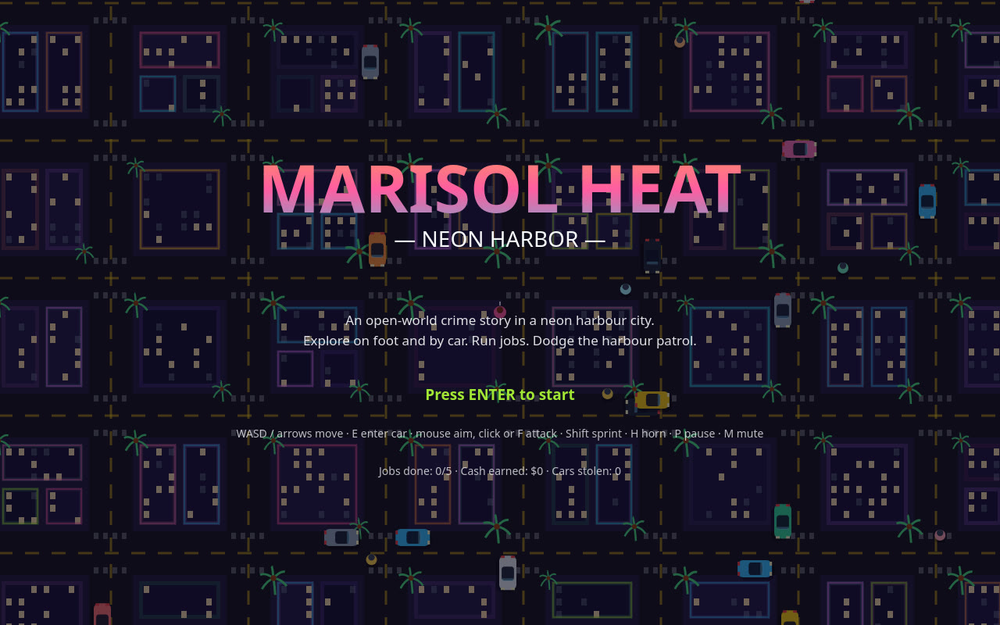
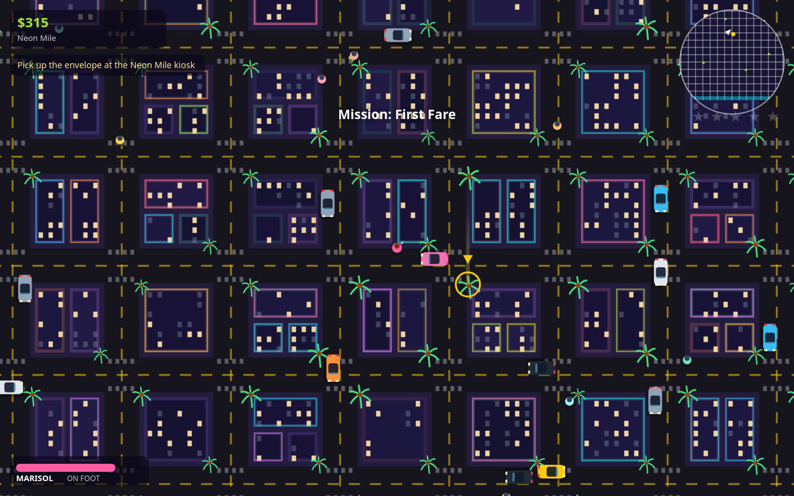
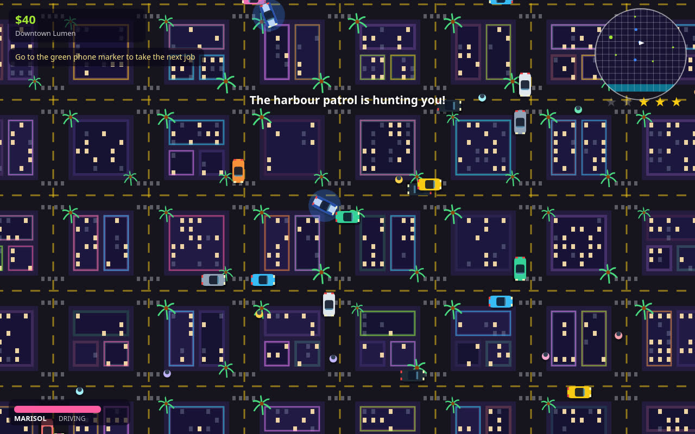
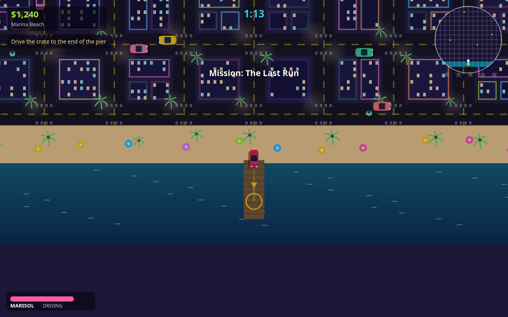

# Marisol Heat — Neon Harbor

An original open-world crime game for the make.fun `gta6-01` bounty ("Make
GTA 6"), built from scratch as plain static files — no build step, no
network, no libraries. Open `game/index.html` in a desktop browser (or run
`node serve.ts` and visit http://localhost:8080) and play.

## The game

Marisol Vega is a dock courier in Neon Harbor, a neon-lit harbour city, and
she owes the Cannery three months of money. Fixer Dee Okafor and dock boss
Renzo feed her a six-job story arc — a quiet envelope run, a stolen coupe,
a loud escape, a harbour time trial, one last drive down the pier, and a
finale that makes the Cannery pay her to rob them — while the harbour
patrol does its best to end her career early. Between jobs the city keeps
paying: side work from Dee's phone, random street events, and twelve neon
tags hidden across the districts.

- **Open world**: a seeded 14×11-block city with named districts, a beach,
  a pier and the sea, explorable on foot and by car, with a full day/night
  cycle that brings the neon out after dark.
- **Traffic & pedestrians**: cars drive the avenue/street grid, brake for
  obstacles and turn at intersections; pedestrians stroll the sidewalks and
  flee from gunfire and sirens.
- **Steal & drive**: parked cars wait at every curb and moving traffic can
  be carjacked. Arcade driving with handbrake, crashes, damage and smoke.
- **Wanted level & police**: crimes raise heat when witnessed. Police cars
  pursue and ram, foot officers chase and shoot, and standing still in
  reach fills the bust meter. Hide long enough and the stars cool off.
  The higher the wanted level, the faster and more aggressive the pursuit.
- **Missions & story**: six jobs with briefings, dialogue, stage markers,
  checkpoints, timers and payouts, plus respawning cash pickups for side
  income.
- **Side jobs (J)**: repeatable work from Dee's phone — taxi fares, courier
  drops and repo jobs — each with its own timer, marker and payout.
- **Street events**: about once a minute the city throws something at
  Marisol — a dropped cash crate, an impromptu three-checkpoint street
  race, or a harbour-patrol raid to survive.
- **Neon tags**: twelve glowing tags hidden across the districts; each pays
  $25, all twelve pay a $500 bonus.
- **Reputation**: jobs, events and tags earn REP through five ranks
  (Street Courier → Neon Royalty), with a cash bonus on each rank-up, slow
  car self-repair from Wheelwoman, and a harder-hitting pistol from
  Harbor Legend.
- **City life**: joggers cross the sidewalks, street vendors hold their
  corners, neon signs name the districts, and plazas gather foot traffic.
- **Combat**: fists from the start, a pistol once Marisol's reputation
  grows; mouse aim, tracers, hit reactions.
- **HUD & minimap**: health, cash, district, reputation rank and progress,
  neon-tag count, objective line, mission timer, wanted stars and a live
  circular minimap with police, objective, side-job, event and tag blips.
- **Screens & save**: animated title screen, pause, busted/wasted flow, a
  story-complete screen, and progress (cash, story, reputation, tags,
  position, stats) saved to `localStorage`.
- **Sound**: all effects are synthesized live with WebAudio — engine hum,
  sirens, horns, crashes, gunshots, cash registers and mission stingers.
  No audio files.

## Controls

| Keys | Action |
| --- | --- |
| WASD / arrows | Move / drive |
| Shift | Sprint |
| E | Enter / exit car |
| Mouse + click, or F | Aim and attack (fists, later pistol) |
| Space | Handbrake (drift: skid marks, smoke, screech) |
| J | Take a side job (taxi / courier / repo) |
| H | Horn |
| P / Esc | Pause |
| M | Mute |
| Enter | Confirm / start |
| N | New game (on the title screen) |

## Screenshots

Real renders of the game, captured in play (see `screenshots/`):

- `screenshots/1-title.jpg` — the animated title screen: "MARISOL HEAT —
  NEON HARBOR" over the night city, with the "Press ENTER to start" prompt,
  a controls summary and Marisol's starting stats (0/5 jobs, $0, 0 cars
  stolen).

  

- `screenshots/2-mission.jpg` — the first job, "First Fare": Marisol on
  foot in Neon Mile, following the marker to pick up the envelope at the
  Neon Mile kiosk, with the objective line, cash display and live minimap
  in the HUD.

  

- `screenshots/3-chase.jpg` — a three-star police chase in Downtown Lumen:
  "The harbour patrol is hunting you!" as patrol cars close in on Marisol's
  car while the wanted stars burn in the corner of the HUD.

  

- `screenshots/4-pier.jpg` — the final job, "The Last Run": driving the
  crate down the pier at Marina Beach against a 1:13 timer, with the sea on
  both sides and the finish marker at the end of the pier.

  

The game needs only a desktop browser — no build step and no network.

## Layout

- `main.ts` — the hand-in program: copies `game/` and `screenshots/` to the
  output directory and writes `dossier.json` with the vendored kit library.
- `game/index.html` — the page.
- `game/src/world.js` — the seeded city: roads, buildings, districts, neon
  signs, plazas, collision.
- `game/src/entities.js` — traffic, pedestrians (walkers, joggers, vendors),
  police AI and spawning.
- `game/src/game.js` — the simulation: player, driving, combat, crime, wanted,
  side jobs, street events, neon tags and reputation.
- `game/src/missions.js` — the six-job story arc, the reputation ladder and
  the neon-tag spots, as data.
- `game/src/sidejobs.js` — repeatable side work: taxi fares, courier drops,
  repo jobs, generated near the player.
- `game/src/events.js` — random street events: cash drops, street races,
  patrol raids, generated near the player.
- `game/src/render.js` — canvas rendering, HUD and minimap, all screens.
- `game/src/audio.js` — the WebAudio sound synth.
- `game/src/input.js` — keyboard and mouse.
- `game/src/save.js` — localStorage persistence.
- `game/src/shots.js` — deterministic `?shot=` scenes used for screenshots.
- `screenshots/` — four real renders of the game (title, mission, chase, pier).

Everything — names, city, characters, story, art and sound — is original to
this entry.
